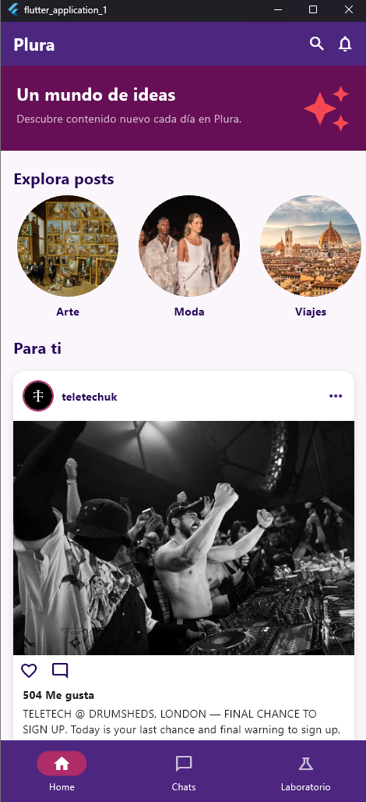
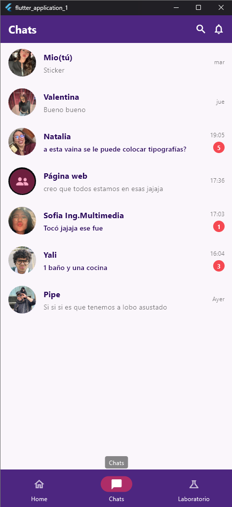
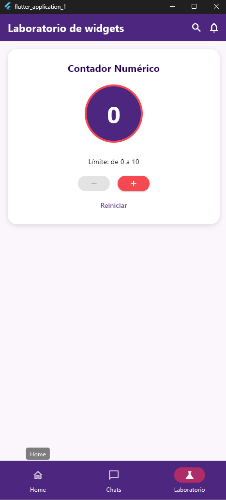

# Plura

**Un mundo de ideas.** App móvil hecha con Flutter y Dart, inspirada en Instagram y Whatsapp, con tres secciones:

- **Home:** banner, carrusel horizontal y publicaciones (`PostCard`) con botón «Me gusta».
- **Chats:** lista de conversaciones con el widget `ChatTile`.
- **Laboratorio de widgets:** selector de cantidad con `setState()` y límites de 0 a 10.

Navegación con `BottomNavigationBar`; el título del `AppBar` cambia según la sección.

## Paleta
`#F54952` · `#AE2D68` · `#660F56` · `#280659` · `#4D2680`

## Cómo ejecutarlo
1. Instalar Flutter y tener un emulador o dispositivo conectado.
2. Clonar el repositorio: `git clone <URL-del-repositorio>`
3. Entrar a la carpeta: `cd plura`
4. Instalar dependencias: `flutter pub get`
5. Ejecutar: `flutter run`

## Capturas

